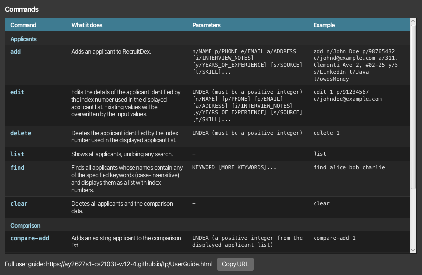

# RecruitDex User Guide

RecruitDex is a desktop application for managing applicant records through commands, with a graphical interface for reviewing applicants, comparisons, and rankings.

<!-- * Table of Contents -->
<page-nav-print />

--------------------------------------------------------------------------------------------------------------------

## Quick start

1. Ensure that Java `25` or later is installed on your computer. 
   **Mac users:** Ensure you have the precise JDK version prescribed [here](https://se-education.org/guides/tutorials/javaInstallationMac.html).

1. Download the latest `.jar` file from the [RecruitDex releases page](https://github.com/AY2627S1-CS2103T-W12-4/tp/releases).

1. Copy the file to the folder you want to use as the _home folder_ for RecruitDex.

1. Open a terminal, `cd` to the folder containing the JAR file, and run `java -jar recruitdex.jar`. 
   A GUI similar to the one below should appear in a few seconds. Note how the app contains some sample data. 
   

   <box type="warning" seamless>

   **Notes about launching:** 
   * Launch the JAR with `java -jar`. Double-clicking the JAR file might not work on your computer, because it can open with a different Java version.
   * The home folder must be **writable**. RecruitDex creates a `data` folder next to the JAR to save your records, so do not put the JAR in a write-protected folder.
   </box>

1. Type a command in the command box and press Enter to execute it. For example, type **`help`** and press Enter to open the Help window, which lists every command. 
   Some example commands you can try:

   * `list` : Lists all applicants.

   * `add -nJohn Doe -p98765432 -ejohnd@example.com -aJohn street, block 123, #01-01` : Adds an applicant named `John Doe`.

   * `delete 3` : Deletes the 3rd applicant shown in the current list.

   * `compare-add 1` : Adds the 1st applicant to the comparison list. Add at least two applicants, then use `choose a` or `choose b` to pick the stronger one of the pair shown in the **Compare** tab.

   * `clear` : Deletes all applicant records.

   * `exit` : Exits the app.

1. Refer to the [Features](#features) section below for details of each command.

--------------------------------------------------------------------------------------------------------------------

## Using the window

* **Command box (top):** type a command here and press Enter. Everything in RecruitDex is done with commands.
* **Result box (below it):** shows what the last command did, or why it failed.
* **Compare tab:** shows two applicants side by side, labelled **A** and **B**, with their details and interview notes. Next to them, the **RANKING** panel lists the applicants in the comparison list from highest to lowest. Use `choose a` or `choose b` to pick the stronger applicant. See [Choosing the stronger applicant](#choosing-the-stronger-applicant-choose).
* **All applicants tab:** lists every applicant record, numbered. Commands such as `edit`, `delete`, `compare-add` and `compare-remove` use these numbers as `INDEX`.
* **Switching tabs:** type `sw` to jump between the **Compare** tab and the **All applicants** tab without using the mouse. See [Switching tabs](#switching-tabs-sw).
* **Help:** click **Help** in the menu bar, press `F1`, or type `help` to see all commands. See [Viewing help](#viewing-help-help).

--------------------------------------------------------------------------------------------------------------------

## Features

<box type="info" seamless>

**Notes about the command format:** 

* Words in `UPPER_CASE` are the parameters to be supplied by the user. 
  For example, in `add -nNAME`, replace `NAME` with a value such as `John Doe`.

* A space between a prefix and its value is optional. 
  For example, `-nJohn Doe` and `-n John Doe` mean the same thing.

* Items in square brackets are optional. 
  For example, `-nNAME [-tSKILL]` can be used as `-nJohn Doe -tJava` or as `-nJohn Doe`.

* Items followed by `...` can appear zero or more times. 
  For example, `[-tSKILL]...` may be omitted, or written as `-tJava` or `-tJava -tKafka`.

* Parameters can be in any order. 
  For example, if the command specifies `-nNAME -pPHONE_NUMBER`, `-pPHONE_NUMBER -nNAME` is also acceptable.

* Extraneous parameters for commands that take no parameters, such as `help`, `list`, `exit`, and `clear`, are ignored. 
  For example, `help 123` is interpreted as `help`.

* If you are using a PDF version of this document, be careful when copying and pasting commands that span multiple lines as space characters surrounding line-breaks may be omitted when copied over to the application.
</box>

### Navigating command history

The command box keeps a history of commands you have submitted, including commands that were invalid.

- Press the **Up Arrow** key to display the most recently submitted command. Press it again to move to older commands.
- Press the **Down Arrow** key to move back toward newer commands.
- Press **Down Arrow** past the most recent command to restore the text you had in the command box before browsing history.

The recalled command appears in the command box and can be edited before you submit it. If you submit a command that fails, it remains in the command box so you can correct it.

The command history does not persist between sessions, so it is cleared once you exit the application.

### Ranking leaderboard

The **RANKING** panel displays applicants in the active comparison list.

* **Position:** Tied applicants share a position, for example `1, 1, 3`.
* **Score:** Higher scores rank earlier. Scores are shown to six decimal places; an unavailable score appears as `—`.
* **Comparisons:** The number of comparisons used for that applicant's ranking. Zero comparisons is marked **Unassessed**.

Searching filters the applicant list and leaves the leaderboard unchanged. Applicant names update after edits.
Commands such as `edit` and `delete` use indices from the **All applicants** list.

Each comparison card also shows the applicant's current position, for example **Rank 4 of 30**, so you can see
their standing without searching the leaderboard. The total includes everyone in the active comparison list,
even when the applicant list is filtered. Ties share a rank, and applicants with no comparisons are marked
**Unassessed**. These positions update with the leaderboard and are not the indices used by applicant commands.

**Current iteration:** The leaderboard starts empty. Its heading shows `0 applicants in comparison list`.
Use `compare-add INDEX` to include an existing applicant in the leaderboard.
Adding applicant records alone leaves the leaderboard empty. Use `choose a` or `choose b` to record a comparison.
Comparison membership, decisions, and any unanswered pair are saved between sessions.

### Viewing help: `help`

Opens the Help window, which lists every command in a table so you can look up a format without leaving RecruitDex.

Format: `help`

* The table has four columns: **Command**, **What it does**, **Parameters** and **Example**. The commands are grouped under **Applicants**, **Comparison** and **General**, and the window scrolls if your screen is small.
* In the **Parameters** column, items in square brackets are optional, and `...` means you can repeat the item. A command that takes no parameters shows `-`.
* You can also open the window by clicking **Help** in the menu bar, or by pressing `F1`.
* The window ends with a link to this user guide, and a **Copy URL** button to copy it.

### Adding an applicant: `add`

Adds an applicant record to RecruitDex.

Format: `add -nNAME [-pPHONE_NUMBER] [-eEMAIL] [-aADDRESS] [-iINTERVIEW_NOTES] [-yYEARS_OF_EXPERIENCE] [-sSOURCE] [-tSKILL]...`

* `INTERVIEW_NOTES` is free text, for example `Strong system design`.
* `YEARS_OF_EXPERIENCE` is a whole number from 0 to 60.
* `SOURCE` is free text saying where the applicant came from, for example `LinkedIn` or `Referral`.
* `SKILL` is entered with the `-t` prefix. An applicant can have any number of skills, including zero. A skill can contain only letters and numbers, so `C++` is not accepted.
* Only the name is required. Phone number, email, address, interview notes, years of experience, source, and skills can all be omitted. Omitted fields are saved as empty values and can be filled in later with `edit`.
* Optional fields other than skills can also be given with nothing after the prefix (for example `-p` or `-i`), which leaves them empty. To add an applicant without skills, omit `-t`; a bare `-t` is not accepted by `add`.
* When provided, a phone number must contain at least 3 digits and only digits, and an email must be a valid email address. Other validation rules still apply to supplied values.

Examples:

* `add -nAlex Tan`
* `add -nSam Lee -esam@example.com -tJava`
* `add -nJohn Doe -p98765432 -ejohnd@example.com -aJohn street, block 123, #01-01`
* `add -nBetsy Crowe -tfriend -ebetsycrowe@example.com -aNewgate Prison -p1234567 -tcriminal`
* `add -nJane Doe -p91234567 -ejane@example.com -aBlk 1 Clementi -y6 -sLinkedIn -iGreat system design -tJava -tKafka`

### Adding an applicant to the comparison list: `compare-add`

Adds an existing applicant to the active comparison list.

Format: `compare-add INDEX`

* `INDEX` is a positive integer referring to the applicant's position in the displayed applicant list.
* After `find`, the index refers to the filtered results.
* The applicant must already have a record and must not already be in the comparison list.
* This command keeps applicant records and the current search filter unchanged.

Examples:

* `list` followed by `compare-add 2` selects the second applicant in the displayed list.
* `find -n Betsy` followed by `compare-add 1` selects the first applicant in the search results.

Adding an applicant updates the ranking immediately. Membership and comparison decisions are saved
with the applicant records and restored when the application reopens. Using `clear` also resets membership.
Once two applicants are in the comparison list, a random pair appears in the comparison panel.
Adding more applicants keeps the current pair. Applicants can be compared repeatedly.

### Removing an applicant from the comparison list: `compare-remove`

Removes an existing applicant from the active comparison list while keeping their record and comparison history.

Format: `compare-remove INDEX`

* `INDEX` is a positive integer referring to the applicant's position in the displayed applicant list.
* After `find`, the index refers to the filtered results.
* The current search filter is kept unchanged.
* Removing an applicant who is already outside the comparison list succeeds without changing membership
  and reports `This applicant is not in the comparison list.`
* Decisions involving the removed applicant are retained but excluded from the current ranking.
  Adding the applicant back makes those decisions eligible again when both participants are active.
* An unanswered comparison involving the removed applicant is cleared or replaced.

Examples:

* `list` followed by `compare-remove 2` selects the second applicant in the displayed list.
* `find -n Betsy` followed by `compare-remove 1` selects the first applicant in the search results.

Removing an applicant updates the ranking immediately. Membership and comparison decisions are saved
with the applicant records. If the applicant is in the unanswered pair, a random replacement pair is selected.
The pair is cleared when fewer than two comparison-list members remain.

### Choosing the stronger applicant: `choose`

Records your choice between the two applicants currently shown in the comparison panel.

Format: `choose a` or `choose b`

* `a` selects the applicant labelled **A**; `b` selects the applicant labelled **B**.
  Uppercase `A` and `B` are also accepted.
* These labels refer to the current comparison pair. Searching the applicant list does not change their meaning.
* A pending pair is required. Add at least two applicants using `compare-add INDEX` to start comparisons.
* The decision is added to the history, the ranking updates immediately, and a random next pair appears.
  The next pair may contain the same applicants, and their sides may change.
* Each repeated choice records a separate decision. Applicant records, membership, and the search filter are retained.
* The decision history and the new pending pair are saved automatically after a successful command.
* Missing or invalid sides, extra arguments, and choices without a valid pending pair are rejected.

For example, run `list`, `compare-add 1`, and `compare-add 2`, review the pair in the comparison panel, then enter
`choose a` to choose the applicant currently labelled **A**. Review the next pair before choosing again.

### Switching tabs: `sw`

Switches between the **Compare** tab and the **All applicants** tab.

Format: `sw`

* If the **Compare** tab is showing, `sw` shows the **All applicants** tab, and the other way round.
* The result box tells you which tab is now showing, for example `Showing the All applicants tab.`
* Only the display changes. Applicant records, the comparison list and the search filter stay the same.
* Unlike `help` or `list`, `sw` does not accept extra text after it. Typing `sw 1` shows an error with the correct format.

### Listing all applicants: `list`

Shows all applicant records.

Format: `list`

### Editing an applicant: `edit`

Edits an existing applicant record.

Format: `edit INDEX [-nNAME] [-pPHONE] [-eEMAIL] [-aADDRESS] [-iINTERVIEW_NOTES] [-yYEARS_OF_EXPERIENCE] [-sSOURCE] [-tSKILL]...`

* Edits the applicant at the specified `INDEX`. The index refers to the index number shown in the displayed applicant list. The index **must be a positive integer** 1, 2, 3, ...
* At least one of the optional fields must be provided.
* Existing values will be updated to the input values.
* When editing skills (`-t`), all of the applicant's existing skills are removed; adding skills is not cumulative.
* To remove all of an applicant's skills, enter `-t` without a skill after it.
* To clear the phone number, email, address, interview notes, years of experience or source, enter its prefix with nothing after it, for example `-p` or `-i`.

Examples:

* `edit 1 -p91234567 -ejohndoe@example.com` edits the phone number and email address of the 1st applicant.
* `edit 2 -nBetsy Crower -t` edits the name of the 2nd applicant and clears all existing skills.
* `edit 1 -y7 -sReferral` sets the years of experience of the 1st applicant to `7` and the source to `Referral`.
* `edit 3 -i` clears the interview notes of the 3rd applicant.

### Finding applicants: `find`

Finds applicants whose details match every supplied condition. You can search by name, phone number, email, address, interview notes, years of experience, source, or skill tags. At least one condition is required.

Format: `find [-n NAME] [-p PHONE] [-e EMAIL] [-a ADDRESS] [-i INTERVIEW_NOTES] [-y YEARS_OF_EXPERIENCE] [-s SOURCE] [-t SKILL_TERMS]`

* Include at least one attribute prefix. The brackets indicate optional attributes; omit the brackets when entering a command.
* Attribute values may contain spaces and can appear in any order. Each prefix may be used at most once.
* When you supply more than one attribute, an applicant must match **all** supplied conditions.
* Name, email, address, interview notes, and source searches are case-insensitive partial matches. The search term does not need to be a complete value, so `-e example.com` matches `alice@example.com`.
* Phone searches match part of the phone number and may contain only digits, e.g. `-p 12`.
* `YEARS_OF_EXPERIENCE` must match the applicant’s value exactly, and must be a whole number from 0 to 60.
* For `-t`, enter one or more space-separated search terms. Each term must partially match at least one skill tag on the applicant. Matching is case-insensitive; different terms may match different tags.
* Every prefix you include must be followed by a search term. For example, `find -s` is rejected.

Examples:

* `find -n Alice` finds applicants whose names contain `Alice`, ignoring case.
* `find -e example.com` finds applicants whose emails contain `example.com`.
* `find -t java kaf` finds applicants with a skill tag matching `java` and a skill tag matching `kaf`.
* `find -n Alice -s LinkedIn -y 5` finds applicants whose name contains `Alice`, whose source contains `LinkedIn`, and whose years of experience is exactly `5`.
* `find -a jurong west -n Alice Pauline` searches by both address and name. Attribute order does not matter.

### Deleting an applicant: `delete`

Permanently deletes the specified applicant record, their comparison membership, and decisions involving them.

Format: `delete INDEX`

* Deletes the applicant at the specified `INDEX`.
* The index refers to the index number shown in the displayed applicant list.
* The index **must be a positive integer** 1, 2, 3, ...
* The ranking updates immediately. An unanswered comparison involving the deleted applicant is replaced,
  or cleared when fewer than two comparison-list members remain.
* Use `compare-remove` to remove an applicant from the ranking while keeping their record and comparison history.

Examples:
* `list` followed by `delete 2` deletes the 2nd applicant in the displayed list.
* `find -n Betsy` followed by `delete 1` deletes the 1st applicant in the results of the `find` command.

### Clearing all entries: `clear`

Deletes all applicant records, and resets the comparison list, the decision history, any unanswered pair and the ranking.

Format: `clear`

* This cannot be undone, so back up the data file first if you might need the data again.

### Exiting the program: `exit`

Exits the program.

Format: `exit`

### Saving the data

RecruitDex automatically saves applicant records, comparison-list membership, decision history, and any unanswered
comparison after successful changes. Reopening RecruitDex restores the saved data and rebuilds the ranking.
You do not need to save manually.

`help`, `sw`, and `exit` don't change your data, so they still work even if saving fails.

RecruitDex writes the data to a temporary file first and only then replaces the data file, so a crash during a save cannot leave a half-written file. If a save fails, for example because the folder is not writable, the command is undone and RecruitDex shows an error message.

### Editing the data file

Applicant records and comparison data are saved automatically as a JSON file
`[JAR file location]/data/recruitdex.json`. Advanced users are welcome to update records directly by editing that
data file. Comparison membership and decisions refer to applicant IDs; an unanswered pair must refer to two active
comparison-list members. If the file has no unanswered pair but has at least two active comparison-list members,
RecruitDex selects a pair on loading without adding a decision or changing the existing history.
A saved valid pair keeps its original A/B sides. Existing files without comparison data load with an empty
comparison list.

<box type="warning" seamless>

**Caution:**
If your changes make the data file invalid, RecruitDex starts with an empty applicant list at the next run. The invalid file remains on disk until you run a successful command that saves records. We recommend backing up the file before editing it. 
Certain edits can cause RecruitDex to behave in unexpected ways (e.g., if a value entered is outside of the acceptable range). Edit the data file only if you are confident that you can update it correctly.
</box>

### Archiving data files `[coming in v2.0]`

_Details coming soon ..._

--------------------------------------------------------------------------------------------------------------------

## FAQ

**Q**: How do I transfer my data to another computer? 
**A**: Install the app on the other computer and overwrite the data file it creates with the data file from your previous RecruitDex home folder.

--------------------------------------------------------------------------------------------------------------------

## Known issues

1. **When using multiple screens**, if you move the application to a secondary screen, and later switch to using only the primary screen, the GUI will open off-screen. The remedy is to delete the `preferences.json` file created by the application before running the application again.
2. **If you minimize the Help Window** and then run the `help` command (or click `Help` in the menu bar, or press `F1`) again, the original Help Window will remain minimized, and no new Help Window will appear. The remedy is to manually restore the minimized Help Window.

--------------------------------------------------------------------------------------------------------------------

## Command summary

Action     | Format, Examples
-----------|----------------------------------------------------------------------------------------------------------------------------------------------------------------------
**Add**    | `add -nNAME [-pPHONE_NUMBER] [-eEMAIL] [-aADDRESS] [-iINTERVIEW_NOTES] [-yYEARS_OF_EXPERIENCE] [-sSOURCE] [-tSKILL]...`   e.g., `add -nJames Ho` or `add -nJames Ho -p22224444 -ejamesho@example.com -a123, Clementi Rd -y5 -sLinkedIn -tJava -tKafka`
**Edit**   | `edit INDEX [-nNAME] [-pPHONE] [-eEMAIL] [-aADDRESS] [-iINTERVIEW_NOTES] [-yYEARS_OF_EXPERIENCE] [-sSOURCE] [-tSKILL]...`  e.g., `edit 2 -nJames Lee -ejameslee@example.com`
**Delete** | `delete INDEX`  e.g., `delete 3`
**List**   | `list`
**Find**   | `find [-n NAME] [-p PHONE] [-e EMAIL] [-a ADDRESS] [-i INTERVIEW_NOTES] [-y YEARS_OF_EXPERIENCE] [-s SOURCE] [-t SKILL_TERMS]`  e.g., `find -n Alice -t java kaf`
**Clear**  | `clear`
**Add to comparison list** | `compare-add INDEX`  e.g., `compare-add 2`
**Remove from comparison list** | `compare-remove INDEX`  e.g., `compare-remove 2`
**Choose stronger applicant** | `choose a` or `choose b`
**Switch tabs** | `sw`
**Help**   | `help`
**Exit**   | `exit`
