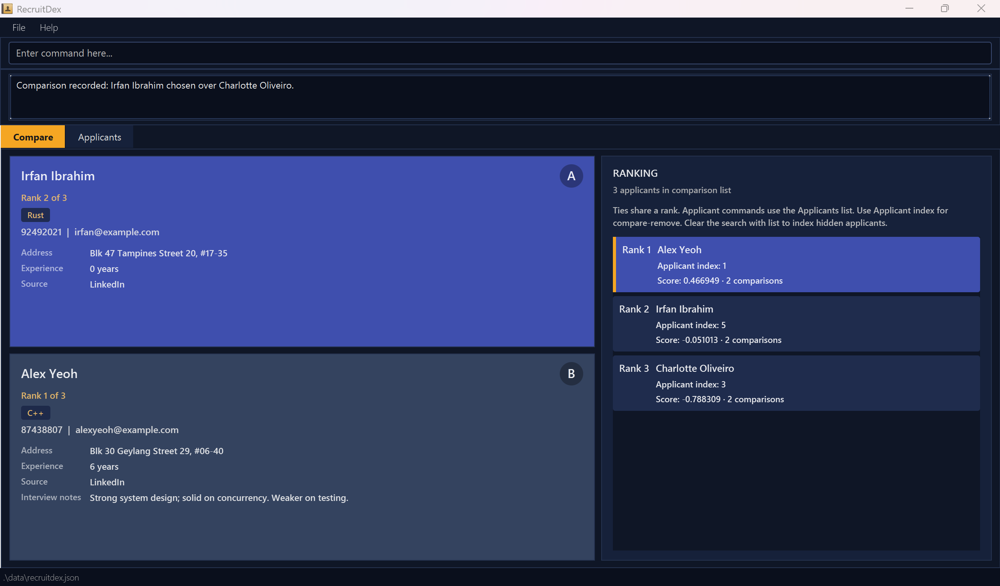
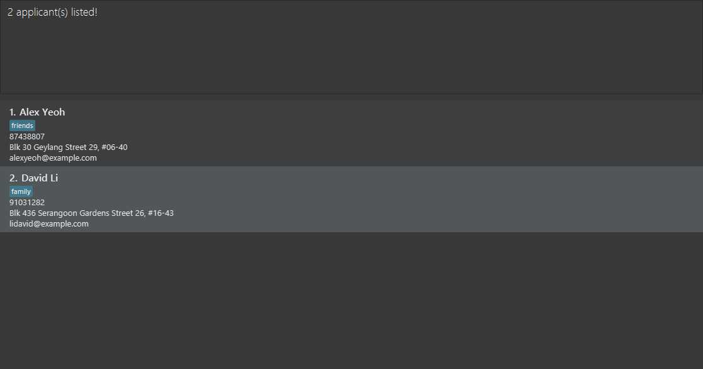

# RecruitDex User Guide

RecruitDex is a desktop application for managing applicant records through commands, with a graphical interface for reviewing applicants, comparisons, and rankings.

<!-- * Table of Contents -->
<page-nav-print />

--------------------------------------------------------------------------------------------------------------------

## Quick start

1. Ensure that Java `25` or later is installed on your computer. 
   **Mac users:** Ensure you have the precise JDK version prescribed [here](https://se-education.org/guides/tutorials/javaInstallationMac.html).

1. Download the latest `.jar` file from the [RecruitDex releases page](https://github.com/AY2627S1-CS2103T-W12-4/tp/releases).

1. Copy the file to the folder you want to use as the _home folder_ for RecruitDex.

1. Open a terminal, `cd` to the folder containing the JAR file, and run `java -jar recruitdex.jar`. 
   A GUI similar to the one below should appear in a few seconds. Note how the app contains some sample data. 
   

1. Type a command in the command box and press Enter to execute it. For example, type **`help`** and press Enter to open the help window. 
   Some example commands you can try:

   * `list` : Lists all applicants.

   * `add n/John Doe p/98765432 e/johnd@example.com a/John street, block 123, #01-01` : Adds an applicant named `John Doe`.

   * `delete 3` : Deletes the 3rd applicant shown in the current list.

   * `clear` : Deletes all applicant records.

   * `exit` : Exits the app.

1. Refer to the [Features](#features) section below for details of each command.

--------------------------------------------------------------------------------------------------------------------

## Features

<box type="info" seamless>

**Notes about the command format:** 

* Words in `UPPER_CASE` are the parameters to be supplied by the user. 
  For example, in `add n/NAME`, replace `NAME` with a value such as `John Doe`.

* Items in square brackets are optional. 
  For example, `n/NAME [t/TAG]` can be used as `n/John Doe t/friend` or as `n/John Doe`.

* Items followed by `...` can appear zero or more times. 
  For example, `[t/TAG]... ` may be omitted, or written as `t/friend` or `t/friend t/family`.

* Parameters can be in any order. 
  For example, if the command specifies `n/NAME p/PHONE_NUMBER`, `p/PHONE_NUMBER n/NAME` is also acceptable.

* Extraneous parameters for commands that take no parameters, such as `help`, `list`, `exit`, and `clear`, are ignored. 
  For example, `help 123` is interpreted as `help`.

* If you are using a PDF version of this document, be careful when copying and pasting commands that span multiple lines as space characters surrounding line-breaks may be omitted when copied over to the application.
</box>

### Ranking leaderboard

The **RANKING** panel displays applicants in the active comparison list.

* **Position:** Tied applicants share a position, for example `1, 1, 3`.
* **Score:** Higher scores rank earlier. Scores are shown to six decimal places; an unavailable score appears as `—`.
* **Comparisons:** The number of comparisons used for that applicant's ranking. Zero comparisons is marked **Unassessed**.

Searching filters the applicant list and leaves the leaderboard unchanged. Applicant names update after edits.
Commands such as `edit` and `delete` use indices from the **All applicants** list.

**Current iteration:** The leaderboard starts empty and shows **No applicants in the comparison list.**
Use `compare-add INDEX` to include an existing applicant in the leaderboard.
Adding applicant records alone leaves the leaderboard empty. Use `choose a` or `choose b` to record a comparison.
Comparison membership, decisions, and any unanswered pair are saved between sessions.

### Viewing help: `help`

Shows a message explaining how to access the help page.

Format: `help`

### Adding an applicant: `add`

Adds an applicant record to RecruitDex.

Format: `add n/NAME p/PHONE_NUMBER e/EMAIL a/ADDRESS [i/INTERVIEW_NOTES] [y/YEARS_OF_EXPERIENCE] [s/SOURCE] [t/SKILL]... `

* `INTERVIEW_NOTES` is free text, for example `Strong system design`.
* `YEARS_OF_EXPERIENCE` is a whole number from 0 to 60.
* `SOURCE` is free text saying where the applicant came from, for example `LinkedIn` or `Referral`.
* `SKILL` is entered with the `t/` prefix. An applicant can have any number of skills, including zero. A skill can contain only letters and numbers, so `C++` is not accepted.
* The optional fields can be left out, or given with nothing after the prefix (for example `i/`), which leaves them empty.

Examples:
* `add n/John Doe p/98765432 e/johnd@example.com a/John street, block 123, #01-01`
* `add n/Betsy Crowe t/friend e/betsycrowe@example.com a/Newgate Prison p/1234567 t/criminal`
* `add n/Jane Doe p/91234567 e/jane@example.com a/Blk 1 Clementi y/6 s/LinkedIn i/Great system design t/Java t/Kafka`

### Adding an applicant to the comparison list: `compare-add`

Adds an existing applicant to the active comparison list.

Format: `compare-add INDEX`

* `INDEX` is a positive integer referring to the applicant's position in the displayed applicant list.
* After `find`, the index refers to the filtered results.
* The applicant must already have a record and must not already be in the comparison list.
* This command keeps applicant records and the current search filter unchanged.

Examples:

* `list` followed by `compare-add 2` selects the second applicant in the displayed list.
* `find Betsy` followed by `compare-add 1` selects the first applicant in the search results.

Adding an applicant updates the ranking immediately. Membership and comparison decisions are saved
with the applicant records and restored when the application reopens. Using `clear` also resets membership.
Once two applicants are in the comparison list, a random pair appears in the comparison panel.
Adding more applicants keeps the current pair. Applicants can be compared repeatedly.

### Removing an applicant from the comparison list: `compare-remove`

Removes an existing applicant from the active comparison list while keeping their record and comparison history.

Format: `compare-remove INDEX`

* `INDEX` is a positive integer referring to the applicant's position in the displayed applicant list.
* After `find`, the index refers to the filtered results.
* The current search filter is kept unchanged.
* Removing an applicant who is already outside the comparison list succeeds without changing membership
  and reports `This applicant is not in the comparison list.`
* Decisions involving the removed applicant are retained but excluded from the current ranking.
  Adding the applicant back makes those decisions eligible again when both participants are active.
* An unanswered comparison involving the removed applicant is cleared or replaced.

Examples:

* `list` followed by `compare-remove 2` selects the second applicant in the displayed list.
* `find Betsy` followed by `compare-remove 1` selects the first applicant in the search results.

Removing an applicant updates the ranking immediately. Membership and comparison decisions are saved
with the applicant records. If the applicant is in the unanswered pair, a random replacement pair is selected.
The pair is cleared when fewer than two comparison-list members remain.

### Choosing the stronger applicant: `choose`

Records your choice between the two applicants currently shown in the comparison panel.

Format: `choose a` or `choose b`

* `a` selects the applicant labelled **A**; `b` selects the applicant labelled **B**.
  Uppercase `A` and `B` are also accepted.
* These labels refer to the current comparison pair. Searching the applicant list does not change their meaning.
* A pending pair is required. Add at least two applicants using `compare-add INDEX` to start comparisons.
* The decision is added to the history, the ranking updates immediately, and a random next pair appears.
  The next pair may contain the same applicants, and their sides may change.
* Each repeated choice records a separate decision. Applicant records, membership, and the search filter are retained.
* The decision history and the new pending pair are saved automatically after a successful command.
* Missing or invalid sides, extra arguments, and choices without a valid pending pair are rejected.

For example, run `list`, `compare-add 1`, and `compare-add 2`, review the pair in the comparison panel, then enter
`choose a` to choose the applicant currently labelled **A**. Review the next pair before choosing again.

### Listing all applicants: `list`

Shows all applicant records.

Format: `list`

### Editing an applicant: `edit`

Edits an existing applicant record.

Format: `edit INDEX [n/NAME] [p/PHONE] [e/EMAIL] [a/ADDRESS] [i/INTERVIEW_NOTES] [y/YEARS_OF_EXPERIENCE] [s/SOURCE] [t/SKILL]... `

* Edits the applicant at the specified `INDEX`. The index refers to the index number shown in the displayed applicant list. The index **must be a positive integer** 1, 2, 3, ...
* At least one of the optional fields must be provided.
* Existing values will be updated to the input values.
* When editing skills (`t/`), all of the applicant's existing skills are removed; adding skills is not cumulative.
* To remove all of an applicant's skills, enter `t/` without a skill after it.
* To clear the interview notes, years of experience or source, enter its prefix with nothing after it, for example `i/`.

Examples:
*  `edit 1 p/91234567 e/johndoe@example.com` Edits the phone number and email address of the 1st applicant to be `91234567` and `johndoe@example.com` respectively.
*  `edit 2 n/Betsy Crower t/` Edits the name of the 2nd applicant to be `Betsy Crower` and clears all existing skills.
*  `edit 1 y/7 s/Referral` Sets the years of experience of the 1st applicant to `7` and the source to `Referral`.
*  `edit 3 i/` Clears the interview notes of the 3rd applicant.

### Locating applicants by name: `find`

Finds applicants whose names contain any of the given keywords.

Format: `find KEYWORD [MORE_KEYWORDS]`

* The search is case-insensitive; for example, `hans` matches `Hans`.
* Keyword order does not matter; for example, `Hans Bo` matches `Bo Hans`.
* The search considers only names.
* Only full words match; for example, `Han` does not match `Hans`.
* Applicants matching at least one keyword are returned (an `OR` search); for example, `Hans Bo` returns `Hans Gruber` and `Bo Yang`.

Examples:
* `find John` returns `john` and `John Doe`
* `find alex david` returns `Alex Yeoh`, `David Li` 
  

### Deleting an applicant: `delete`

Permanently deletes the specified applicant record, their comparison membership, and decisions involving them.

Format: `delete INDEX`

* Deletes the applicant at the specified `INDEX`.
* The index refers to the index number shown in the displayed applicant list.
* The index **must be a positive integer** 1, 2, 3, ...
* The ranking updates immediately. An unanswered comparison involving the deleted applicant is replaced,
  or cleared when fewer than two comparison-list members remain.
* Use `compare-remove` to remove an applicant from the ranking while keeping their record and comparison history.

Examples:
* `list` followed by `delete 2` deletes the 2nd applicant in the displayed list.
* `find Betsy` followed by `delete 1` deletes the 1st applicant in the results of the `find` command.

### Clearing all entries: `clear`

Clears all applicant records and the runtime ranking.

Format: `clear`

### Exiting the program: `exit`

Exits the program.

Format: `exit`

### Saving the data

RecruitDex automatically saves applicant records, comparison-list membership, decision history, and any unanswered
comparison after every successful command. Reopening RecruitDex restores this data and rebuilds the ranking.
You do not need to save manually.

### Editing the data file

Applicant records and comparison data are saved automatically as a JSON file
`[JAR file location]/data/recruitdex.json`. Advanced users are welcome to update records directly by editing that
data file. Comparison membership and decisions refer to applicant IDs; an unanswered pair must refer to two active
comparison-list members. Existing files without comparison data load with an empty comparison list.

<box type="warning" seamless>

**Caution:**
If your changes make the data file invalid, RecruitDex starts with an empty applicant list at the next run. The invalid file remains on disk until you run a successful command that saves records. We recommend backing up the file before editing it. 
Certain edits can cause RecruitDex to behave in unexpected ways (e.g., if a value entered is outside of the acceptable range). Edit the data file only if you are confident that you can update it correctly.
</box>

### Archiving data files `[coming in v2.0]`

_Details coming soon ..._

--------------------------------------------------------------------------------------------------------------------

## FAQ

**Q**: How do I transfer my data to another computer? 
**A**: Install the app on the other computer and overwrite the data file it creates with the data file from your previous RecruitDex home folder.

--------------------------------------------------------------------------------------------------------------------

## Known issues

1. **When using multiple screens**, if you move the application to a secondary screen, and later switch to using only the primary screen, the GUI will open off-screen. The remedy is to delete the `preferences.json` file created by the application before running the application again.
2. **If you minimize the Help Window** and then run the `help` command (or use the `Help` menu, or the keyboard shortcut `F1`) again, the original Help Window will remain minimized, and no new Help Window will appear. The remedy is to manually restore the minimized Help Window.

--------------------------------------------------------------------------------------------------------------------

## Command summary

Action     | Format, Examples
-----------|----------------------------------------------------------------------------------------------------------------------------------------------------------------------
**Add**    | `add n/NAME p/PHONE_NUMBER e/EMAIL a/ADDRESS [t/TAG]... `   e.g., `add n/James Ho p/22224444 e/jamesho@example.com a/123, Clementi Rd, 1234665 t/friend t/colleague`
**Clear**  | `clear`
**Add to comparison list** | `compare-add INDEX`  e.g., `compare-add 2`
**Remove from comparison list** | `compare-remove INDEX`  e.g., `compare-remove 2`
**Choose stronger applicant** | `choose a` or `choose b`
**Delete** | `delete INDEX`  e.g., `delete 3`
**Edit**   | `edit INDEX [n/NAME] [p/PHONE_NUMBER] [e/EMAIL] [a/ADDRESS] [t/TAG]... `  e.g.,`edit 2 n/James Lee e/jameslee@example.com`
**Find**   | `find KEYWORD [MORE_KEYWORDS]`  e.g., `find James Jake`
**List**   | `list`
**Help**   | `help`
