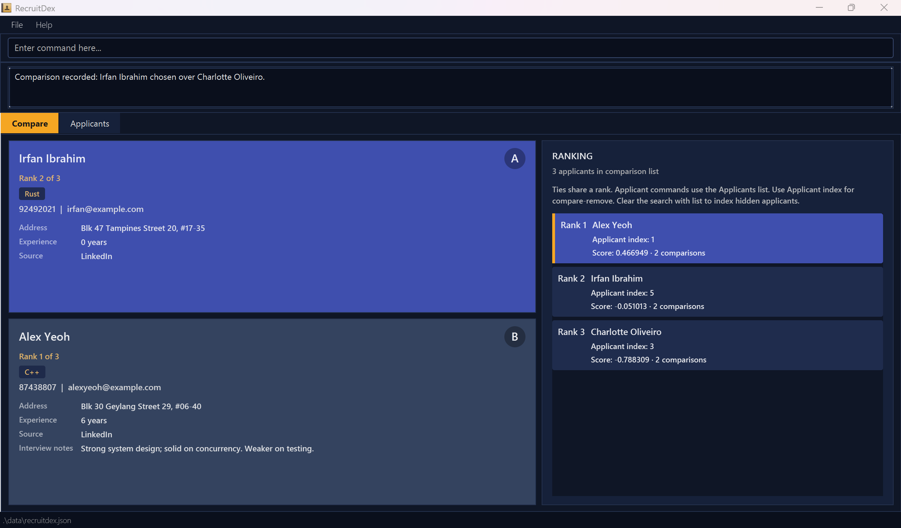

# RecruitDex

**RecruitDex is a desktop applicant contact manager for software engineering recruiters that keeps applicant details and interview notes together and builds a ranking from side-by-side comparisons to inform shortlisting decisions.**

## Who is RecruitDex for?

RecruitDex is designed for recruiters handling many applicants for software engineering roles who need to review their skills, experience, and interview notes to decide whom to shortlist. It suits recruiters who prefer desktop applications, can type fast, and are comfortable using a CLI (Command Line Interface). Typed commands are the primary input; the graphical interface displays applicant records, comparisons, and rankings.

## How does RecruitDex help?

Keeping applicant contact details up to date while deciding how candidates compare can become difficult as the applicant pool grows. RecruitDex supports this work in three ways:

* **Keep applicant information together.** Maintain contact details alongside skills, years of experience, recruitment sources, and interview notes. Search these records to find relevant applicants without scanning the entire list.
* **Build a ranking one decision at a time.** Select applicants from your records for the active comparison list, review the two applicants presented side by side, and choose the stronger one. RecruitDex updates the ranking after each choice, so you can assess pairs instead of ordering the whole pool in one sitting. Further comparisons can change an applicant's position.
* **Review progress and continue later.** See rankings, scores, and comparison counts, with unassessed applicants shown separately. Applicant records and comparison progress are saved locally between sessions.

## Scope

RecruitDex manages applicant contacts and supports assessment through one active comparison list at a time. Rankings reflect your comparison choices; you supply the assessment criteria and make the hiring decisions. Communication with applicants, interview scheduling, and tracking hiring stages are outside its scope.

## Getting started

* If you are interested in using RecruitDex, head over to the [_Quick Start_ section of the **User Guide**](UserGuide.html#quick-start).
* If you are interested in developing RecruitDex, the [**Developer Guide**](DeveloperGuide.html) is a good place to start.

**Acknowledgements**

* This project is based on AddressBook Level 3 from the [se-education.org](https://se-education.org) initiative.
* Libraries used: [JavaFX](https://openjfx.io/), [Jackson](https://github.com/FasterXML/jackson), [JUnit5](https://github.com/junit-team/junit5)
